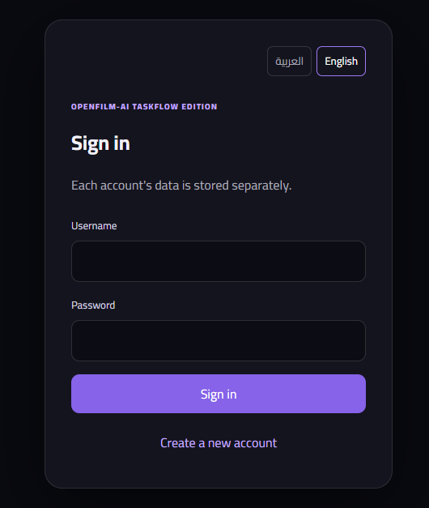

<<<<<<< HEAD
# AI TASKFLOW
=======
# OPENFILM-AI TASKFLOW EDITION
>>>>>>> f17599aa (feat: force add and sync all remaining project folders and files)

[](https://gitdiagram.com/adam-mahmoud12/ai-workflow?utm_source=readme&utm_medium=picture)

[](https://gitdiagram.com/adam-mahmoud12/ai-workflow?utm_source=readme&utm_medium=badge)

Created by **ADAM MAHMOUD ABDELALIM**.

AI TaskFlow combines task and project management with configurable AI providers, visual planning, design tools, and local editing engines. The interface language can be selected in **Settings → Interface language**.



## دليل الاستخدام بالعربية

### التشغيل لأول مرة

على Windows 10/11، شغّل المثبّت لإعداد البرنامج كاملًا، ثم افتحه من اختصار سطح المكتب أو قائمة Start. يتضمن المثبّت إصدارًا محمولًا من Python وNode.js وBun، ومكتبات الخلفية والواجهة والمحركات وملفات البناء اللازمة؛ لا يحتاج تثبيت التطبيق إلى WinGet أو تنزيل الاعتماديات. شغّل `start-all.bat` يدويًا فقط إذا أردت تشغيل المشروع من مجلده. يلزم اتصال الإنترنت عند استخدام مزوّد AI سحابي أو جلب محتوى خارجي.

لتشغيل نسخة المصدر من موجه أوامر Windows (CMD)، شغّل `start-all.bat`. يفحص المشغّل الاعتماديات والمحركات، ويطلب موافقتك قبل تنزيل أي حزم ناقصة، ثم يختار المنافذ المتاحة ويعرض رابط الجهاز. استخدم `install-prerequisites.bat` إذا أردت فحص/إعداد المتطلبات دون تشغيل الخوادم.

### استخدام الأقسام

- **المهام والمشروعات:** أنشئ المهام واربطها بالمشروعات، وحدّث الحالة والصعوبة، وتابع الملخص ونسبة الإنجاز من الصفحة الرئيسية.
- **مزوّدو الذكاء الاصطناعي:** أضف مزوّدًا متوافقًا مع OpenAI أو Ollama، اختبر الاتصال، ثم اختره للمحادثة والأدوات.
- **محادثة AI ومنظّم AI:** استخدم سياق مساحة العمل والمستندات لتوليد خطط أو جداول أو إجابات بحث. راجع النتائج قبل اعتماد التغييرات.
- **مخطط التدفق والمهارات:** أنشئ مخططات العمل باستخدام صيغة W2M/2 الصارمة، واحفظ تعليمات قابلة لإعادة الاستخدام ليستدعيها المساعد لاحقًا.
- **استوديو التصميم:** أنشئ أو عدّل شعارات SVG من خلال برنامج W2M/2 مضبوط الإحداثيات والطبقات، وابحث عن صور مرخّصة. راجع الإسناد والترخيص قبل النشر.
- **المخططات المعمارية:** أنشئ مخطط W2M/2، ثم عدّله في OpenCalque ثنائي الأبعاد أو حوّله إلى مشروع في محرر AI TaskFlow 3D.
- **استوديو الموشن جرافيك:** أنشئ مشروع OpenFilm، وعدّل صفحات المشاهد والـTimeline داخل المحرر. تستخدم طبقة W2M/2 لغة نصية محدّدة القواعد، وتتحقق من بنية المشاهد ومددها ومراجع الـTimeline قبل الحفظ؛ ويمكنها إعادة طلب إصلاح المصدر عند فشل الترجمة. يمكن إرسال ثلاث لقطات من فيديو مرجعي إلى مزوّد AI؛ لا يُرسل الفيديو كاملًا. يبقى الفويس أوفر داخل المشروع، ويحلل FFmpeg الصوت محليًا ويرسل توقيتات المقاطع الهادئة فقط.
- **تسليم Telegram:** بعد إنشاء نتيجة قابلة للتصدير، يمكن إرسال ملفها إلى البوت إذا أُعدّ وربط البوت بحسابك؛ لا يُرسل شيء تلقائيًا عند غياب الربط.
- **Markdown ومركز المساعدة:** اكتب المستندات، واطلب من AI مراجعتها، واستخدم مركز المساعدة للخطوات التفصيلية.

### الحسابات والشبكة والمحركات

أول حساب يُنشأ على الجهاز المضيف يصبح المسؤول. يستطيع المسؤول تفعيل موافقة التسجيلات، وقبول أو رفض الحسابات الجديدة، والتحكم بإعدادات الشبكة والمحركات. تطبق جلسة الحساب في طلبات API سواء كان التسجيل المتعدد مفعّلًا أو معطّلًا؛ وفي وضع تعدد المستخدمين تُعزل بيانات مساحة العمل ومزوّدو AI ومشروعات OpenFilm لكل حساب.

التشغيل على الجهاز فقط هو الوضع الافتراضي. للوصول من جهاز آخر على الشبكة المحلية، سجّل الدخول كمسؤول، أوقف خيار «تشغيل على هذا الجهاز فقط»، احفظ، ثم أعد تشغيل `start-all.bat`. سيطبع المشغّل عنوان IP والرابط. قد تحتاج إلى السماح بالخدمات في جدار حماية Windows. لا تعرض التطبيق على الإنترنت العام؛ وضع الشبكة مخصص لشبكة محلية موثوقة فقط.

من إعدادات المسؤول يمكن إيقاف محرك المخططات 2D أو 3D أو OpenFilm لتوفير الموارد. تُطبّق تغييرات المحركات والشبكة بعد إعادة تشغيل `start-all.bat`. لا يبدأ OpenFilm إلا عند فتح قسم الموشن.

### طبقة ترجمة أوامر AI

تستخدم AI TaskFlow طبقة تكامل مخصّصة كتبها **ADAM MAHMOUD ABDELALIM** بين طلب المستخدم والنموذج وبين أدوات التطبيق والمحركات:

1. تجمع الطبقة طلب المستخدم وسياق مساحة العمل الحالي، ثم تصوغه بتعليمات ومخطط استجابة محدّد للمزوّد النصي المختار.
2. تحوّل استجابة النموذج إلى صيغة القسم: `taskflow-actions` للمحادثة وأوامر مساحة العمل، وW2M/2 للمخطط التدفق والجداول والتصميم والمخططات المعمارية ومشروعات OpenFilm.
3. تتحقق من نوع الأمر والحقول والمعرّفات والحدود والبنية قبل التنفيذ؛ وتمنع تمرير نص حر إلى عمليات التطبيق أو المحرك كأمر غير مقيّد.
4. يطبّق منفّذ الأوامر التغييرات الموافق عليها على مساحة العمل أو يرسل هندسة المشهد إلى المحرك، ثم يحفظ بيانات التطبيق في قاعدة البيانات.
5. لكل قسم قواعد وأوامر مختلفة؛ تعرض الواجهة البرنامج النصي والنتيجة في تبويبين. تتحقق المحللات من الحقول والأنواع والحدود والمراجع قبل تطبيق المخطط أو تصميم SVG أو تحرير المشروع. في OpenFilm، يتحقق المترجم أيضًا من تسلسل الصفحات وبنية HTML و`window.film.frame(t)` ومدد المشاهد واتصال الـTimeline قبل الحفظ. هذه الفحوص تقلل أخطاء التنسيق والبنية لكنها لا تضمن جودة التصميم أو صحة كل شفرة HTML.

هذه خوارزمية ربط وتطبيع وتنفيذ خاصة بالمشروع، وليست نموذجًا جديدًا ولا ادعاءً بأن النموذج دُرّب محليًا. النموذج النصي لا يتحكم مباشرة بالمحرك؛ الطبقة تحوّل اللغة الطبيعية إلى واجهات وأوامر محدودة يفهمها المحرك.

### الخصوصية والبيانات

تُخزّن قاعدة SQLite وملفات المشاريع محليًا ضمن `backend/data`، ويُحفظ مفتاح تشفير مزوّدي AI في `backend/.env`. ينشئ المشغّل مفتاحًا عشوائيًا عند أول تشغيل ولا يستبدل الملف الموجود. احتفظ بنسخة آمنة منه؛ فقدانه يمنع فك تشفير مفاتيح المزوّدين المحفوظة. عند اختيار مزوّد سحابي، تُرسل إليه الطلبات والمرفقات التي تختار استخدامها وفق سياسة ذلك المزوّد. راجع `PRIVACY.md` ونصّي الموافقة داخل `installer/`.

### إنشاء نسخة Windows

يتطلب بناء النسخة وجود PyInstaller وInno Setup 6. شغّل:

```powershell
.\scripts\package-windows.ps1
```

ينشئ السكربت `release\OPENFILM-AI TASKFLOW EDITION.exe` ومثبّت Inno Setup كاملًا في `installer\output`. يضم المثبّت اعتمادات المشروع والمحركات وبناء المحرك ثلاثي الأبعاد ونسخًا محمولة من Python وNode.js وBun، لذلك حجمه كبير لكنه يثبت دون اتصال أو WinGet. يتطلب المثبّت قبول اتفاقية الخصوصية بالإنجليزية أو العربية قبل المتابعة. ملف EXE داخل مجلد `release` أداة تشغيل للمشروع المثبّت؛ استخدم المثبّت لإعداد نسخة قابلة للتشغيل، ولا تنقل ملف EXE وحده.

## English guide

### First run

On Windows 10/11, run the setup installer, then launch the app from its Start-menu or desktop shortcut. The installer includes portable Python, Node.js, and Bun runtimes, the backend/frontend/engine dependencies, and the required engine build files; installing the application does not require WinGet or dependency downloads. Run `start-all.bat` manually only when launching the project from its folder. Internet is needed for cloud AI providers or external content.

To run a source checkout from Windows Command Prompt (CMD), launch `start-all.bat`. It checks dependencies and engines, asks before downloading missing packages, then selects available ports and prints the local access URL. Run `install-prerequisites.bat` to check/setup prerequisites without starting the services.

### Using the sections

- **Tasks and Projects:** create tasks, assign projects and difficulty, track completion, and review the overview.
- **AI Providers:** add an OpenAI-compatible provider or Ollama, test it, and select it for chat and tools.
- **AI Chat and Planner:** use workspace and document context to generate plans, tables, or sourced research. Review changes before applying them.
- **Flowchart and Skills:** create visual workflows through the strict W2M/2 flowchart format, and save reusable instructions for later AI requests.
- **Design Studio:** create or edit SVG logos through a coordinate- and layer-aware W2M/2 program, and search licensed image sources; review attribution and license terms before publishing.
- **Architectural Plan:** generate a W2M/2 plan, edit it in the OpenCalque 2D editor, or convert it into a scene in AI TaskFlow 3D.
- **Telegram delivery:** exportable results can be sent to a configured, linked bot; artifacts are not sent when the bot is unavailable.
- **Motion Graphics:** create an OpenFilm project and edit its scenes and timeline in the embedded editor. W2M/2 is a versioned, grammar-based text language for project metadata and raw HTML blocks. Its compiler checks scene numbering, HTML/frame structure, declared durations, and sequential timeline references before saving, and can request AI repair when compilation fails. Three still frames may be sent from a video reference to the selected AI provider; the full video is not sent. Voiceover remains in the local project; FFmpeg analyzes it locally and only quiet-span timings are sent to the provider.
- **Markdown and Help Center:** write documents, ask AI to revise them, and follow the in-app guides.

### Accounts, network access, and engines

The first account created on the host becomes administrator. The administrator can require approval for new registrations, approve or reject accounts, and manage network and engine settings. Account sessions remain enforced by API requests whether or not multi-user registration is enabled. In multi-user mode, workspace data, AI providers, and OpenFilm projects are scoped to each account.

Device-only mode is the default. To allow other devices on your local network, sign in as administrator, turn off **Run on this device only**, save, and restart `start-all.bat`. The launcher prints the host IP and URL. Windows Firewall may ask you to allow access. Do not expose this app directly to the public internet; LAN mode is intended only for a trusted local network.

Disable the 2D, 3D, or OpenFilm engine from administrator settings to save host resources. Network and engine changes apply after restarting `start-all.bat`. OpenFilm starts on demand when Motion Graphics is opened.

### AI command translation layer

The project's custom integration layer, created by **ADAM MAHMOUD ABDELALIM**, connects natural-language requests and text models to application tools and engines:

1. It combines the user's request with current workspace context and provider-specific instructions/schema.
2. It converts model output into the section-specific format: `taskflow-actions` for workspace/chat commands and W2M/2 for flowcharts, tables, design, architectural plans, and OpenFilm projects.
3. It validates command types, fields, identifiers, limits, and data shape before execution; invalid output is rejected rather than sent as arbitrary text to an engine.
4. The dispatcher applies approved actions to the workspace or sends scene geometry to an engine, then persists application state.
5. Each section has its own versioned W2M/2 grammar and commands. The UI presents the program and resulting artifact in separate tabs. Parsers validate fields, types, limits, and references before applying a chart, SVG design, plan, or project. The OpenFilm compiler additionally validates scene order, HTML/frame structure, clip durations, and timeline continuity before saving. These structural checks reduce formatting errors but cannot guarantee visual quality or all runtime behavior.

This is a project-specific command translation and execution algorithm, not a new trained model. The text model does not directly control an engine; the adapter translates natural language into a constrained interface the engine can process.

### Privacy and data

SQLite and project files are stored locally under `backend/data`; the provider-encryption key is stored in `backend/.env`. The launcher generates a key only if the file is absent. Keep a safe backup: losing the key prevents decryption of saved provider keys. When a cloud provider is selected, prompts and chosen attachments are sent to that provider under its terms. See `PRIVACY.md` and the installer agreement files.

### Build the Windows release

With PyInstaller and Inno Setup 6 installed, run:

```powershell
.\scripts\package-windows.ps1
```

This creates `release\OPENFILM-AI TASKFLOW EDITION.exe` and the complete Inno Setup package under `installer\output`. The installer bundles project and engine dependencies, the 3D engine build, and portable Python/Node.js/Bun runtimes, so it is large but installs without WinGet or an internet connection. Users must accept the English or Arabic privacy agreement to continue. The EXE in `release` is a launcher for an installed project; use the setup installer rather than distributing the launcher alone.

OpenCalque is MIT-licensed and included from `vendor/opencalque`; its license and other notices are retained in the vendor tree and `THIRD_PARTY_NOTICES.md`. OpenFilm is MIT-licensed; see `THIRD_PARTY_NOTICES.md`. The OpenFilm name and logo belong to their respective owners; this integration is not endorsed by the OpenFilm project.
