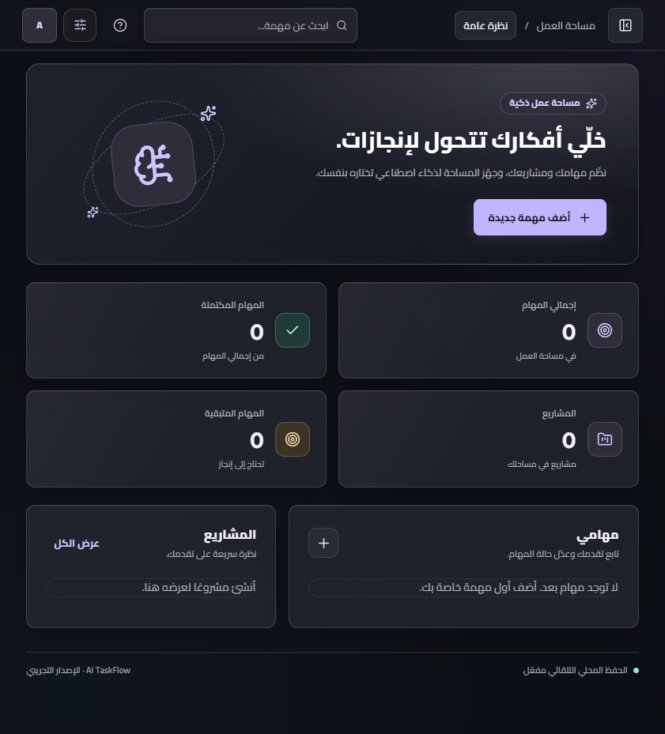
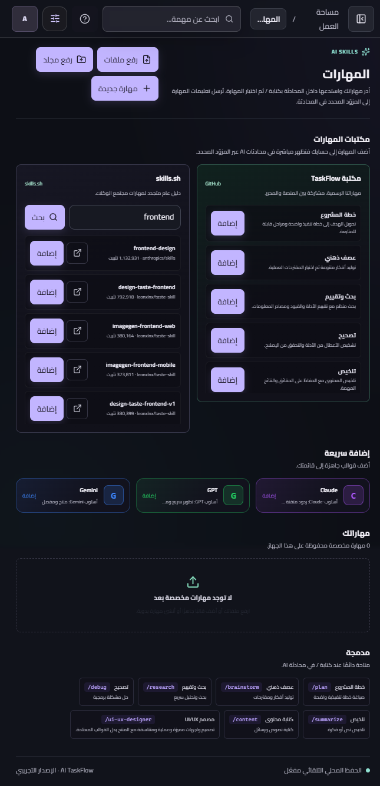

# AI TASKFLOW EDITION

Created by **ADAM MAHMOUD ABDELALIM**.

AI TaskFlow combines task and project management with configurable AI providers, visual planning, design tools, and local editing engines. The interface language can be selected in **Settings → Interface language**.

| AI TaskFlow dashboard | Shared skill libraries |
|---|---|
|  |  |

Reusable instructions are shared between the web app and the TF CODE agent through the
[AI-TASKFLO-SKILLS library](https://github.com/ADAM-MAHMOUD12/AI-TASKFLO-SKILLS).
Browse the catalog in TaskFlow, add skills to your account, and use them in AI
chat, including TF CODE agent mode, with the provider selected for that account.

[](https://gitdiagram.com/adam-mahmoud12/ai-workflow?utm_source=readme&utm_medium=badge)
[](https://gitdiagram.com/adam-mahmoud12/ai-workflow?utm_source=readme&utm_medium=picture)
## دليل الاستخدام بالعربية

### التشغيل لأول مرة

على Windows 10/11، شغّل المثبّت لإعداد البرنامج كاملًا، ثم افتحه من اختصار سطح المكتب أو قائمة Start. يتضمن المثبّت إصدارًا محمولًا من Python وNode.js وBun، ومكتبات الخلفية والواجهة والمحركات وملفات البناء اللازمة؛ لا يحتاج تثبيت التطبيق إلى WinGet أو تنزيل الاعتماديات. شغّل `start-all.bat` يدويًا فقط إذا أردت تشغيل المشروع من مجلده. يلزم اتصال الإنترنت عند استخدام مزوّد AI سحابي أو جلب محتوى خارجي.

لتشغيل نسخة المصدر من موجه أوامر Windows (CMD)، شغّل `start-all.bat`. يبني المشغّل أحدث نسخة من المصدر، ويفحص الاعتماديات والمحركات المفعّلة، ويسألك قبل تثبيت أي مكوّن ناقص. بعد اختيار المنافذ ينتظر جاهزية الخدمات ثم يفتح رابط التطبيق الصحيح تلقائيًا. إذا رفضت تثبيت اعتماد ضروري لمحرك مفعّل، يُلغي التشغيل بدلًا من فتح واجهة لا تعمل بالكامل. يبدأ OpenFilm عند فتح قسم الموشن جرافيك. استخدم `install-prerequisites.bat` إذا أردت فحص/إعداد المتطلبات دون تشغيل الخوادم.

### النشر على Vercel

تُعدّ هذه النسخة من مجلد `vercel edition`، مع ضبطه كـ **Root Directory** في Vercel. تُقدّم الواجهة على `/` وFastAPI عبر `/api/*`، وتتطلب PostgreSQL ومفتاح `TASKFLOW_ENCRYPTION_KEY` ثابتًا و`TASKFLOW_PUBLIC_URL` لإعداد webhooks تيليجرام. شغّل `vercel edition\app\start-all.bat` لتجهيز المحركات المحلية، ثم `vercel edition\start-local-assistant.bat` لربط ميزات الجهاز الإضافية بالموقع المستضاف. لربط VS Code، ثبّت إضافة TF CODE، واختر **TF CODE: Connect to TaskFlow**، ثم أدخل الرمز المؤقت الذي تعرضه الإضافة في صفحة البرمجة. تبدأ الإضافة اتصال HTTPS صادرًا؛ لا يحتاج المتصفح إلى إذن شبكة محلية، وتبقى الملفات والطرفية على جهاز المستخدم. تتطلب عمليتا Git pull وpush تأكيدًا منفصلًا داخل VS Code، وتستخدمان بيانات اعتماد Git المحلية. تعمل بوتات Telegram على Vercel عبر webhooks بدل polling دائم. يفرض وضع Vercel عزل الحسابات وموافقة المدير للحسابات الجديدة؛ فعّل **Deployment Protection** مؤقتًا عند إنشاء حساب المدير الأول، لأن أول تسجيل يصبح حساب المدير.

### استخدام الأقسام

- **المهام والمشروعات:** أنشئ المهام واربطها بالمشروعات، وحدّث الحالة والصعوبة، وتابع الملخص ونسبة الإنجاز من الصفحة الرئيسية.
- **مزوّدو الذكاء الاصطناعي:** أضف مزوّدًا متوافقًا مع OpenAI أو Ollama، اختبر الاتصال، ثم اختره للمحادثة والأدوات.
- **محادثة AI ومنظّم AI:** استخدم سياق مساحة العمل والمستندات لتوليد خطط أو جداول أو إجابات بحث. راجع النتائج قبل اعتماد التغييرات.
- **TF CODE على Windows:** اضغط **تجهيز وفتح TF CODE** لفتح المشروع في Visual Studio Code. إذا لم يكن المحرر موجودًا، ينزّل TaskFlow مُثبّت المستخدم الرسمي من Microsoft عبر HTTPS، ويتحقق من توقيع Microsoft قبل التثبيت دون صلاحيات مسؤول. ثم يثبت أو يحدّث إضافة TF CODE المضمّنة ويفتح المشروع كمستخدم عادي حتى لو كان مشغّل TaskFlow مرتفع الصلاحيات. التثبيت التلقائي متاح على Windows فقط؛ يجب ربط الإضافة بالمنصة بشكل منفصل وبموافقة المستخدم.
- **مكتبة الإضافات والمهارات في TF CODE:** زر **مكتبة الإضافات والمهارات** يفتح مكتبة خاصة بالإضافات والمهارات من صفحة البرمجة، ويعرض الإضافات المثبتة ويمكن تثبيت الإضافات المعتمدة عبر VS Code CLI. المهارات المضافة في AI TaskFlow تُشارك تلقائيًا مع محادثة الإضافة الجانبية، ومكتبة المهارات الرسمية تظهر داخل نفس واجهة المكتبة. - **وكيل TF CODE وفريقه:** يتطلب التقاط مخرجات الطرفية VS Code 1.93 أو أحدث. اربط الإضافة من صفحة TF CODE في TaskFlow بموافقة VS Code؛ احفظ حزمة الإضافة المحدثة ثم أعد تحميل نافذة VS Code. يظهر **TF CODE Chat** في شريط النشاط: يمكن بدء الربط منه بفتح TaskFlow المحلي، ثم اختيار اتصال VS Code هناك، واختيار مزوّد AI للمحادثة. تعرض الإضافة حالة الاتصال الحي، وتتحول إلى غير متصل عند توقف نبض TaskFlow ثم تعود عند فتحه، بينما تحفظ آخر 20 محادثة في مساحة العمل مع إمكان التبديل بينها وبدء محادثة جديدة. يقرأ السياق الملف النشط والتشخيصات المنقّحة. التغييرات تعرض معاينة قبل التطبيق في وضع الموافقة، وتُطبّق داخل مستند VS Code المفتوح وتحفظه، كما تظهر مخرجات الطرفية مباشرة. فعّل الفريق اختياريًا في محادثة TF CODE؛ يضم افتراضيًا مصممًا ومبرمجًا وديباجر/مختبِرًا، وتظهر مناقشاتهم وتعديلات الملفات والأوامر ونتائجها في سجل المحادثة. يمكن تعديل تعليمات الأعضاء بصيغة Markdown، استيراد مهارات Markdown أو إضافة أعضاء حتى 8، وتُشارك المهارات المحفوظة. عند فشل التحقق يحاول الفريق إصلاحًا وإعادة اختبار مرة واحدة. الوضع التلقائي يطبق التعديلات ويشغّل الأوامر دون موافقة منفصلة، مع تحذير ظاهر؛ الحذف وبعض أوامر VS Code الحساسة تظل تتطلب تأكيدًا. الطرفية غير معزولة وتعمل بصلاحيات حسابك، وتحذيرات النموذج لا تضمن سلامة الأمر. إيقاف الدورة يرسل مقاطعة إلى أمر الطرفية الجاري.
- **مخطط التدفق والمهارات:** أنشئ مخططات العمل بصيغة W2M/2، واستعرض مكتبة TaskFlow والمهارات المجتمعية. أضف المهارات إلى حسابك لاستخدامها في محادثات AI مع المزوّد المختار، ومنها وكيل TF CODE.
- **استوديو التصميم:** أنشئ أو عدّل شعارات SVG من خلال برنامج W2M/2 مضبوط الإحداثيات والطبقات، وابحث عن صور مرخّصة. يمكن تثبيت Florence-2 ONNX (حتى 500 MB) لتحليل الصور المرجعية وصور المكتبة والتحقق محليًا من لقطة النتيجة؛ قد يُرسل وصف التحليل النصي للمزوّد المختار لتوليد البرنامج، ولا تُرسل الصور نفسها إليه من هذا المسار. تعرض تنزيلات Florence-2 وWhisper وأصوات Piper حجم النقل الفعلي والحجم الإجمالي والمتبقي.
- **المخططات المعمارية:** أنشئ مخطط W2M/2، ثم عدّله في OpenCalque ثنائي الأبعاد أو حوّله إلى مشروع في محرر AI TaskFlow 3D.
- **استوديو الموشن جرافيك والمونتاج:** اختر إنتاج فيلم كرتوني أو درس أو قصة أو إعلان، وارفع حتى 3 صور مرجعية للشخصيات، وحدد المقاس والمدة ومعدل الحركة، ثم ارفع فويس أوفر أو سجّله من المتصفح وراجعه على Timeline OpenFilm الحقيقي. صور الشخصيات تُرسل للمزوّد المختار إذا كان يقبل الصور؛ وإلا يحللها Florence-2 محليًا ويرسل أوصافها النصية فقط. الفيديو المرجعي لا يُرفع؛ تُستخرج منه محليًا ثلاث لقطات. طبقة W2M/2 تتحقق من بنية المشاهد ومددها ومراجع الـTimeline قبل الحفظ، ويمكنها طلب إصلاح المصدر عند فشل الترجمة. اختَر **افتح TF CODE** من قسم الموشن للانتقال إلى المحرر.
- **تسليم Telegram:** بعد إنشاء نتيجة قابلة للتصدير، يمكن إرسال ملفها إلى البوت إذا أُعدّ وربط البوت بحسابك؛ لا يُرسل شيء تلقائيًا عند غياب الربط.
- **Markdown ومركز المساعدة:** اكتب المستندات، واطلب من AI مراجعتها، واستخدم مركز المساعدة للخطوات التفصيلية.

### الحسابات والشبكة والمحركات

أول حساب يُنشأ على الجهاز المضيف يصبح المسؤول. يستطيع المسؤول تفعيل موافقة التسجيلات، وقبول أو رفض الحسابات الجديدة، والتحكم بإعدادات الشبكة والمحركات. تطبق جلسة الحساب في طلبات API سواء كان التسجيل المتعدد مفعّلًا أو معطّلًا؛ وفي وضع تعدد المستخدمين تُعزل بيانات مساحة العمل ومزوّدو AI ومشروعات OpenFilm لكل حساب.

يمكن حفظ أكثر من حساب على المتصفح من **الإعدادات → الحسابات والربط** أو من شاشة تسجيل الدخول. تتيح الشاشة إضافة حساب بديل، تبديله دون إدخال كلمة المرور مجددًا، إزالة الحساب من الجهاز، وحذفه نهائيًا مع بياناته ومزوّدي AI وحساب GitHub المرتبط به. الحساب النشط ظاهر بوضوح ولا تنتقل مفاتيح المزود إلى حساب آخر.

التشغيل على الجهاز فقط هو الوضع الافتراضي. للوصول من جهاز آخر على الشبكة المحلية، سجّل الدخول كمسؤول، أوقف خيار «تشغيل على هذا الجهاز فقط»، احفظ، ثم أعد تشغيل `start-all.bat`. سيطبع المشغّل عنوان IP والرابط. قد تحتاج إلى السماح بالخدمات في جدار حماية Windows. لا تعرض التطبيق على الإنترنت العام؛ وضع الشبكة مخصص لشبكة محلية موثوقة فقط.

من إعدادات المسؤول يمكن إيقاف محرك المخططات 2D أو 3D أو OpenFilm لتوفير الموارد. تُطبّق تغييرات المحركات والشبكة بعد إعادة تشغيل `start-all.bat`. لا يبدأ OpenFilm إلا عند فتح قسم الموشن.

### طبقة ترجمة أوامر AI

تستخدم AI TaskFlow طبقة تكامل مخصّصة كتبها **ADAM MAHMOUD ABDELALIM** بين طلب المستخدم والنموذج وبين أدوات التطبيق والمحركات:

1. تجمع الطبقة طلب المستخدم وسياق مساحة العمل الحالي، ثم تصوغه بتعليمات ومخطط استجابة محدّد للمزوّد النصي المختار.
2. تحوّل استجابة النموذج إلى صيغة القسم: `taskflow-actions` للمحادثة وأوامر مساحة العمل، وW2M/2 للمخطط التدفق والجداول والتصميم والمخططات المعمارية ومشروعات OpenFilm.
3. تتحقق من نوع الأمر والحقول والمعرّفات والحدود والبنية قبل التنفيذ؛ وتمنع تمرير نص حر إلى عمليات التطبيق أو المحرك كأمر غير مقيّد.
4. يطبّق منفّذ الأوامر التغييرات الموافق عليها على مساحة العمل أو يرسل هندسة المشهد إلى المحرك، ثم يحفظ بيانات التطبيق في قاعدة البيانات.
5. لكل قسم قواعد وأوامر مختلفة؛ تعرض الواجهة البرنامج النصي والنتيجة في تبويبين. تتحقق المحللات من الحقول والأنواع والحدود والمراجع قبل تطبيق المخطط أو تصميم SVG أو تحرير المشروع. في استوديو التصميم، يستطيع Florence-2 تحليل الصور محليًا واستخراج وصف ومناطق أجسام ونصوص؛ وتُفحص لقطة SVG بعد التنفيذ، مع محاولتي تصحيح كحد أقصى لمشكلات حدود اللوحة أو تداخل النصوص. في OpenFilm، يتحقق المترجم أيضًا من تسلسل الصفحات وبنية HTML و`window.film.frame(t)` ومدد المشاهد واتصال الـTimeline قبل الحفظ. هذه الفحوص تقلل أخطاء التنسيق والبنية لكنها لا تضمن جودة التصميم أو صحة كل شفرة HTML.

هذه خوارزمية ربط وتطبيع وتنفيذ خاصة بالمشروع، وليست نموذجًا عامًا جديدًا مدرّبًا. يستخدم استوديو التصميم نموذج Florence-2 مُدرّبًا مسبقًا للتحليل البصري المحلي، بينما يولّد المزوّد النصي المختار برنامج W2M؛ ثم يتحقق التطبيق منه وينفذه عبر موصل SVG المحدود.

### الخصوصية والبيانات

تُخزّن قاعدة SQLite وملفات المشاريع محليًا ضمن `backend/data`، ويُحفظ مفتاح تشفير مزوّدي AI في `backend/.env`. ينشئ المشغّل مفتاحًا عشوائيًا عند أول تشغيل ولا يستبدل الملف الموجود. احتفظ بنسخة آمنة منه؛ فقدانه يمنع فك تشفير مفاتيح المزوّدين المحفوظة. عند اختيار مزوّد سحابي، تُرسل إليه الطلبات والمرفقات التي تختار استخدامها وفق سياسة ذلك المزوّد. راجع `PRIVACY.md` ونصّي الموافقة داخل `installer/`.

### إنشاء نسخة Windows

يتطلب بناء النسخة وجود PyInstaller وInno Setup 6. شغّل:

```powershell
.\scripts\package-windows.ps1
```

ينشئ السكربت `release\OPENFILM-AI TASKFLOW EDITION.exe` ومثبّت Inno Setup كاملًا في `installer\output`. يضم المثبّت اعتمادات المشروع والمحركات وبناء المحرك ثلاثي الأبعاد ونسخًا محمولة من Python وNode.js وBun، لذلك حجمه كبير لكنه يثبت دون اتصال أو WinGet. يتطلب المثبّت قبول اتفاقية الخصوصية بالإنجليزية أو العربية قبل المتابعة. ملف EXE داخل مجلد `release` أداة تشغيل للمشروع المثبّت؛ استخدم المثبّت لإعداد نسخة قابلة للتشغيل، ولا تنقل ملف EXE وحده.

## English guide

### First run

On Windows 10/11, run the setup installer, then launch the app from its Start-menu or desktop shortcut. The installer includes portable Python, Node.js, and Bun runtimes, the backend/frontend/engine dependencies, and the required engine build files; installing the application does not require WinGet or dependency downloads. Run `start-all.bat` manually only when launching the project from its folder. Internet is needed for cloud AI providers or external content.

To run a source checkout from Windows Command Prompt (CMD), launch `start-all.bat`. It rebuilds the current source, checks dependencies and enabled engines, asks before downloading missing runtimes or packages, selects available ports, waits for services to respond, and opens the ready local URL. Startup is cancelled if you decline a missing dependency required by an enabled engine. OpenFilm starts on demand when Motion Graphics is opened. Run `install-prerequisites.bat` to check/setup prerequisites without starting the services.

### Using the sections

- **Tasks and Projects:** create tasks, assign projects and difficulty, track completion, and review the overview.
- **AI Providers:** add an OpenAI-compatible provider or Ollama, test it, and select it for chat and tools.
- **AI Chat and Planner:** use workspace and document context to generate plans, tables, or sourced research. Review changes before applying them.
- **TF CODE on Windows:** click **Prepare and Open TF CODE** to open the project in Visual Studio Code. If VS Code is missing, TaskFlow downloads the official Microsoft per-user installer over HTTPS, verifies its Microsoft Authenticode signature, and installs it without administrator privileges. It installs or updates the bundled TF CODE bridge extension and opens the project. This setup is currently Windows-only; pairing the extension with the web app remains a separate, explicit step.
- **TF CODE extension and skills library:** the Programming view provides a dedicated library for curated VS Code extensions and TaskFlow skills. Curated extensions can be installed through the VS Code CLI, and saved AI TaskFlow skills are included in TF CODE Chat context. - **TF CODE agent and team:** the paired extension requires VS Code 1.93 or later for terminal output capture. Pair it from the TaskFlow TF CODE page and approve the connection in VS Code, then reload VS Code after installing the updated bundle. **TF CODE Chat** appears in the Activity Bar; its Connect button opens local TaskFlow, where you can sign in, pair VS Code, and select an AI provider for chat. The extension reports live presence and switches offline when TaskFlow stops heartbeating; it reconnects when TaskFlow is reopened. It saves the latest 20 conversations in the workspace, with conversation switching and a New Chat action. It reads the active editor and sanitized diagnostics. Code changes can be reviewed and are applied and saved through the open VS Code document; terminal output streams into the chat. Optionally enable the team in TaskFlow chat; defaults are designer, programmer, and debugger/tester. Their discussion, changes, commands, and results appear live. Edit role instructions in Markdown, import Markdown skills, or add members (up to 8); saved custom skills are shared with roles. After a failed verification, the team makes one repair-and-retest pass. Review mode waits for approval; automatic mode applies changes and runs commands without a separate per-command approval, with a warning. File deletion and certain sensitive VS Code commands still require confirmation. Terminal commands are not sandboxed and run with the user's account privileges, so may affect files outside the workspace; AI warnings cannot guarantee safety. Stopping the run sends an interrupt to the active terminal command. The extension uses VS Code APIs, not mouse/keyboard input in other applications.
- **Motion Graphics and Editing:** choose cartoon, lesson, story, or advertisement; add up to three character reference photos; set the canvas ratio, requested length, and motion cadence; and upload or record voice-over for review in the actual OpenFilm timeline. Character photos are sent to the selected provider only when it accepts images; otherwise Florence-2 analyzes them locally and only descriptions are sent. The source reference video is not uploaded; three frames are sampled locally. The W2M/2 compiler checks scene structure, duration, and timeline references. Use **Open TF CODE** in Motion Graphics to switch to the code editor.
- **Flowchart and Skills:** create visual workflows through the strict W2M/2 format, browse the shared TaskFlow and community skills libraries, and use saved skills in AI chat with the account's selected provider, including TF CODE agent mode.
- **Design Studio:** create or edit SVG logos through a coordinate- and layer-aware W2M/2 program, and search licensed image sources. Florence-2 ONNX (up to 500 MB) can analyze reference/library images and verify the rendered result locally; text-only analysis may be sent to the selected provider to generate the program, not the images themselves. Florence-2, Whisper, and Piper downloads show the actual transferred, total, and remaining bytes.
- **Architectural Plan:** generate a W2M/2 plan, edit it in the OpenCalque 2D editor, or convert it into a scene in AI TaskFlow 3D.
- **Telegram delivery:** exportable results can be sent to a configured, linked bot; artifacts are not sent when the bot is unavailable.
- **Motion Graphics:** create an OpenFilm project and edit its scenes and timeline in the embedded editor. W2M/2 is a versioned, grammar-based text language for project metadata and raw HTML blocks. Its compiler checks scene numbering, HTML/frame structure, declared durations, and sequential timeline references before saving, and can request AI repair when compilation fails. Three frames are extracted and analyzed locally with Florence-2; the full video is never uploaded. If the selected provider does not accept images, only the local text descriptions are sent instead. Voiceover remains in the local project; FFmpeg analyzes it locally and only quiet-span timings are sent to the provider.
- **Markdown and Help Center:** write documents, ask AI to revise them, and follow the in-app guides.

### Accounts, network access, and engines

The first account created on the host becomes administrator. The administrator can require approval for new registrations, approve or reject accounts, and manage network and engine settings. Account sessions remain enforced by API requests whether or not multi-user registration is enabled. In multi-user mode, workspace data, AI providers, and OpenFilm projects are scoped to each account.

Multiple accounts can be saved in the browser under **Settings → Accounts and Linking** or on the sign-in screen. The account manager supports adding an alternative account, switching to it without re-entering the password, removing an account from the device only, and permanently deleting an account together with its providers and linked GitHub account. The active account is always identified clearly, and provider credentials are never transferred to another account.

Device-only mode is the default. To allow other devices on your local network, sign in as administrator, turn off **Run on this device only**, save, and restart `start-all.bat`. The launcher prints the host IP and URL. Windows Firewall may ask you to allow access. Do not expose this app directly to the public internet; LAN mode is intended only for a trusted local network.

Disable the 2D, 3D, or OpenFilm engine from administrator settings to save host resources. Network and engine changes apply after restarting `start-all.bat`. OpenFilm starts on demand when Motion Graphics is opened.

### AI command translation layer

The project's custom integration layer, created by **ADAM MAHMOUD ABDELALIM**, connects natural-language requests and text models to application tools and engines:

1. It combines the user's request with current workspace context and provider-specific instructions/schema.
2. It converts model output into the section-specific format: `taskflow-actions` for workspace/chat commands and W2M/2 for flowcharts, tables, design, architectural plans, and OpenFilm projects.
3. It validates command types, fields, identifiers, limits, and data shape before execution; invalid output is rejected rather than sent as arbitrary text to an engine.
4. The dispatcher applies approved actions to the workspace or sends scene geometry to an engine, then persists application state.
5. Each section has its own versioned W2M/2 grammar and commands. The UI presents the program and resulting artifact in separate tabs. Parsers validate fields, types, limits, and references before applying a chart, SVG design, plan, or project. In the Design Studio, Florence-2 can analyze images locally and inspect a rendered SVG screenshot; the adapter retries up to twice for detected canvas-boundary or text-overlap issues. The OpenFilm compiler additionally validates scene order, HTML/frame structure, clip durations, and timeline continuity before saving. These checks reduce structural errors but cannot guarantee visual quality or all runtime behavior.

This is a project-specific command translation and execution algorithm, not a newly trained general-purpose model. The Design Studio uses a pretrained local Florence-2 vision model; the selected text provider generates W2M, which the adapter validates and executes through the constrained SVG editor interface.

### Privacy and data

SQLite and project files are stored locally under `backend/data`; the provider-encryption key is stored in `backend/.env`. The launcher generates a key only if the file is absent. Keep a safe backup: losing the key prevents decryption of saved provider keys. When a cloud provider is selected, prompts and chosen attachments are sent to that provider under its terms. See `PRIVACY.md` and the installer agreement files.

### Build the Windows release

With PyInstaller and Inno Setup 6 installed, run:

```powershell
.\scripts\package-windows.ps1
```

This creates `release\OPENFILM-AI TASKFLOW EDITION.exe` and the complete Inno Setup package under `installer\output`. The installer bundles project and engine dependencies, the 3D engine build, and portable Python/Node.js/Bun runtimes, so it is large but installs without WinGet or an internet connection. Users must accept the English or Arabic privacy agreement to continue. The EXE in `release` is a launcher for an installed project; use the setup installer rather than distributing the launcher alone.

OpenCalque is MIT-licensed and included from `vendor/opencalque`; its license and other notices are retained in the vendor tree and `THIRD_PARTY_NOTICES.md`. OpenFilm is MIT-licensed; see `THIRD_PARTY_NOTICES.md`. The OpenFilm name and logo belong to their respective owners; this integration is not endorsed by the OpenFilm project.

The dashboard shell integrates adapted React layout and sidebar components and design tokens from [shadcnstore/shadcn-dashboard-landing-template](https://github.com/shadcnstore/shadcn-dashboard-landing-template), pinned to commit `866423741fa4b62d5e9427603cb2174aedf00f80`. Existing TaskFlow routes, editors, state, authentication, and localization remain in place; template demo pages and assets are not included. See `THIRD_PARTY_NOTICES.md` for the source files and MIT license.
